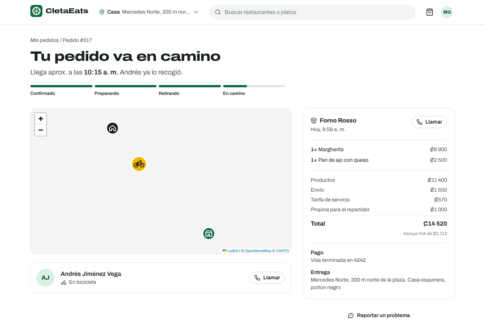
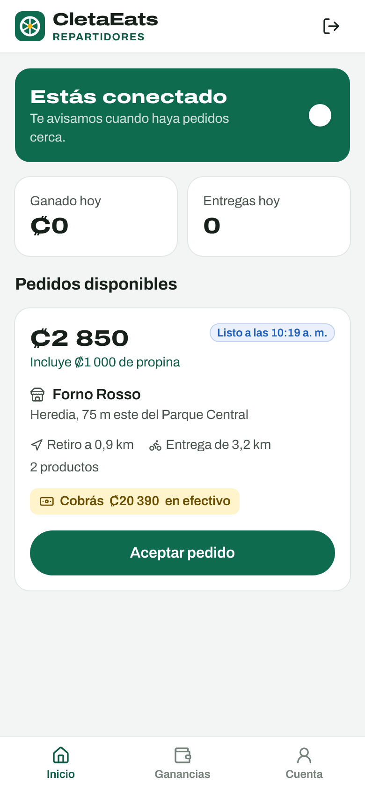
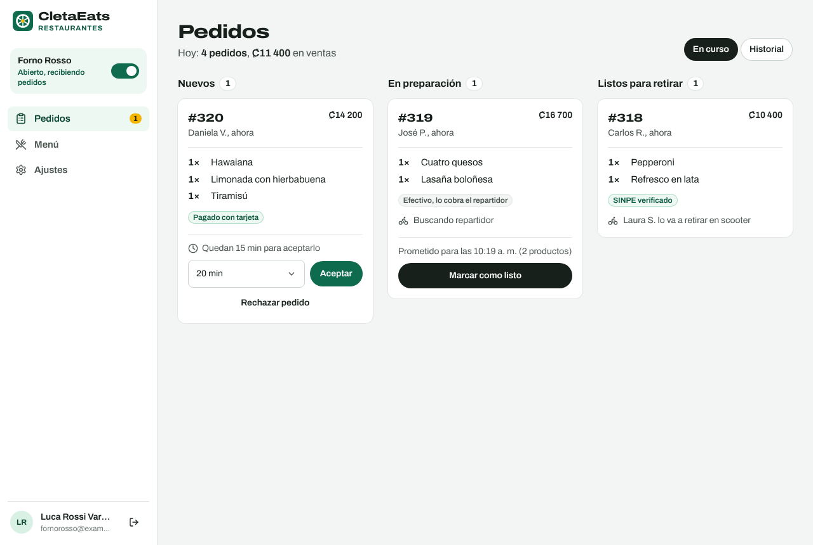
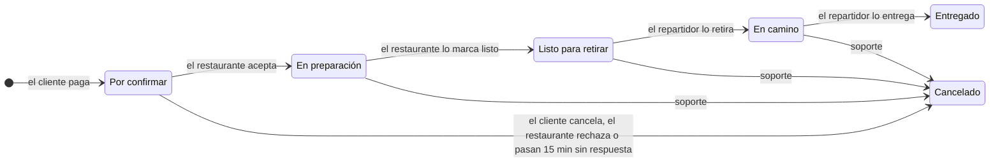
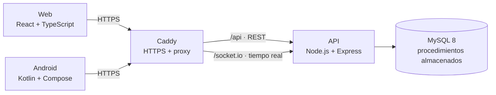

<div align="center">

# CletaEats

**App de delivery de comida para Heredia, Costa Rica: clientes, restaurantes, repartidores en bici y soporte, con los pedidos y la ubicación del repartidor en tiempo real.**

[](https://github.com/MementoMoriX29/cletaeats/actions/workflows/ci.yml)
[](https://github.com/MementoMoriX29/cletaeats/actions/workflows/codeql.yml)


</div>

> **EN ·** Food-delivery platform modeled on how apps like Uber Eats work: one login for every role, a public catalog with delivery fee and ETA per address, server-side pricing (road distance, delivery fee, service fee, VAT included, tip), restaurants that accept or reject orders live, couriers who claim nearby orders (first come, first served, enforced with row locks in MySQL), live tracking over authenticated Socket.IO, simulated card / SINPE Móvil / cash payments, ratings, incident reports and a support console. React + TypeScript web app and a Node.js/Express API on MySQL 8 stored procedures, covered by 75 integration tests that run against a real MySQL in CI.

<table>
<tr>
<td width="62%"></td>
<td width="38%" rowspan="2"></td>
</tr>
<tr>
<td></td>
</tr>
<tr>
<td align="center"><sub>Cliente · seguimiento en vivo &nbsp;/&nbsp; Restaurante · pedidos</sub></td>
<td align="center"><sub>Repartidor · pedidos disponibles</sub></td>
</tr>
</table>

---

## Qué hace cada quien

Hay un solo inicio de sesión: la cuenta ya sabe si es de un cliente, un restaurante, un repartidor o soporte, y cada quien entra a su sección.

| Rol | Qué hace |
|---|---|
| **Cliente** | Ve los restaurantes sin necesidad de cuenta, con el costo de envío y el tiempo estimado hasta su dirección. Arma el carrito, paga con tarjeta, SINPE Móvil o efectivo, deja propina y sigue el pedido en vivo con el repartidor en el mapa. Al final califica al repartidor y al restaurante, y puede reportar un problema. |
| **Restaurante** | Recibe los pedidos al instante (con aviso sonoro), los acepta indicando el tiempo de preparación o los rechaza con un motivo, y los marca listos. Abre y cierra la tienda y maneja su menú: productos, precios y agotados. |
| **Repartidor** | Envía una solicitud que soporte revisa. Ya aprobado, se conecta, ve los pedidos disponibles cerca con lo que gana en cada uno y acepta el que le sirve: el primero que lo acepta se lo lleva. Lo retira, lo entrega compartiendo su ubicación y ve sus ganancias. |
| **Soporte** | Ve los indicadores del negocio, aprueba o rechaza repartidores, da de alta restaurantes junto con la cuenta de su dueño, suspende cuentas, cancela pedidos y resuelve reportes con reembolso o amonestación. No tiene enlace público: se entra por `/admin`. |

## Cómo avanza un pedido



Los repartidores ven el pedido apenas el restaurante lo acepta, para llegar justo cuando esté listo. Cada cambio de estado lo valida la base de datos dentro de una transacción: un pedido no se puede marcar listo dos veces, retirar antes de tiempo ni tomar por dos repartidores a la vez.

## Reglas de negocio

| Tema | Regla |
|---|---|
| **Precio** | Lo calcula siempre el servidor con los productos y la dirección; el navegador solo elige. Los precios del menú incluyen IVA (13 %), como se muestran al consumidor en Costa Rica. |
| **Envío** | ₡700 + ₡350 por km de recorrido (distancia en línea recta × 1,3 por las calles), redondeado a ₡50. En feriados nacionales sube 25 %. Radio máximo: 7 km. |
| **Tarifa de servicio** | 5 % del subtotal, con mínimo de ₡250 y máximo de ₡1 500. |
| **Propina** | Opcional; el 100 % es para el repartidor, igual que el envío. |
| **Pagos** | Tarjeta: se valida y se convierte en un token en el navegador; al servidor solo llegan el token, la marca y los últimos 4 dígitos. SINPE Móvil: el cliente indica el comprobante y queda pagado cuando el restaurante acepta. Efectivo: el repartidor ve cuánto cobrar y el vuelto. En la demo los pagos son simulados. |
| **Tiempos** | Si el restaurante no acepta en 15 minutos, el pedido se cancela solo y se reembolsa. El tiempo estimado suma preparación, trayecto (4 min por km) y entrega. |
| **Repartidores** | Uno lleva un pedido a la vez. Con 4 amonestaciones la cuenta se suspende sola. |
| **Calificaciones** | Una por pedido, al repartidor y al restaurante por separado, solo después de la entrega. |

## Arquitectura



En producción, la web y la API comparten dominio: Caddy sirve la web y redirige `/api` y `/socket.io` al contenedor de la API, así no hay CORS entre ellas y el HTTPS es automático. En desarrollo, Vite hace lo mismo.

El tiempo real funciona como en las apps grandes: el servidor avisa por Socket.IO que algo cambió y cada pantalla vuelve a pedir sus datos a la API, que aplica los permisos. Así un aviso nunca filtra datos que esa persona no puede ver.

| Parte | Tecnologías | Detalle |
|---|---|---|
| [`backend/`](backend) | Node.js 22, Express 5, Socket.IO, zod, JWT, bcrypt, helmet | API en capas (rutas → servicios → DAO), validación de entrada con zod. [README](backend/README.md) |
| [`db/`](db) | MySQL 8 | 12 tablas, 2 vistas, 64 procedimientos almacenados con transacciones y datos de demostración |
| [`web/`](web) | React 19, TypeScript, Vite, Tailwind, TanStack Query, Leaflet, Recharts | Las cuatro secciones; mapas con OpenStreetMap. [README](web/README.md) |
| [`android/`](android) | Kotlin, Jetpack Compose, Retrofit, Room, WorkManager | Cliente Android; inicio de sesión, registro y perfil ya usan la API nueva ([estado](android/README.md)) |

## Seguridad

Resumen; el detalle, con la matriz de permisos y la relación con OWASP Top 10, está en [**SECURITY.md**](SECURITY.md).

- **Control de acceso en el servidor**: cada pedido lo ven solo el cliente, el restaurante y el repartidor que participan, y soporte; para cualquier otra persona no existe (404). El canal de tiempo real aplica las mismas reglas.
- **Sesiones que se pueden revocar**: cada petición revisa la cuenta. Una suspensión o un cambio de contraseña cierran las sesiones abiertas al instante.
- **La tarjeta no llega al servidor**: solo el token de la pasarela, la marca y los últimos 4 dígitos.
- **El dinero lo calcula el servidor**: precios, envío, tarifa, IVA y reembolsos; si el total cambió desde que el cliente lo vio, se le avisa en lugar de cobrar otro monto.
- **Evidencia en CI**: tests de permisos y de carreras contra MySQL real, CodeQL, gitleaks, `npm audit` y Dependabot.

## Correrlo en local

**Con Docker** (MySQL + API):

```bash
docker compose up -d --build
docker compose exec api npm run db:setup                 # tablas, procedimientos y datos de demostración
docker compose exec api npm run create-admin -- soporte@cletaeats.local "Soporte"   # pide la contraseña
cd web && npm install && npm run dev                     # http://localhost:5173
```

Si ya tenías la base de la versión anterior, `db:setup` lo detecta y pide recrearla: `docker compose exec api npm run db:setup -- --reset` (borra los datos).

**Sin Docker:** MySQL 8 y Node.js 22 instalados; seguí [`backend/README.md`](backend/README.md#correrlo-en-local) y después `cd web && npm install && npm run dev`.

Cuentas de demostración (contraseña `Password123`):

| Rol | Correo |
|---|---|
| Cliente | `maria.garcia@example.com` |
| Restaurante | `fornorosso@example.com` (Forno Rosso) · `lacasona@example.com` (Soda La Casona) |
| Repartidor | `andres.jimenez@example.com` · `laura.solis@example.com` |
| Solicitud de repartidor pendiente | `diego.mora@example.com` |
| Soporte | la que creaste con `create-admin` |

La base de demostración trae 8 restaurantes de Heredia con su menú y los pedidos de los últimos 30 días, para que el panel de soporte tenga datos.

## Tests

```bash
cd backend && npm test      # 75 tests de integración (necesita MySQL; usa la base cletaeats_test)
```

Cubren el pedido completo de punta a punta, dos repartidores aceptando el mismo pedido al mismo tiempo, los tres métodos de pago, cancelaciones, rechazos y reembolsos, qué puede ver y hacer cada rol, la revocación de sesiones, el cálculo de precios y feriados en hora de Costa Rica, y el canal de Socket.IO. En GitHub Actions corren contra un MySQL 8 real en cada push a `main` y en cada pull request, junto con el lint y el build de la web, la compilación de Android y la imagen Docker.

## Estructura

```
├── backend/          API REST + Socket.IO, scripts de base de datos, tests y Dockerfile
├── db/               01_schema.sql · 02_routines.sql · 03_seed.sql
├── web/              app web (React + Vite): clientes, restaurantes, repartidores y soporte
├── android/          cliente Android (Kotlin + Compose)
├── docs/
│   ├── paper/        métricas y resumen técnico de la primera versión (paper del curso)
│   ├── conflictos/   problemas encontrados en la primera versión y cómo se resolvieron
│   └── img/          capturas
├── docker-compose.yml
└── SECURITY.md
```

## Contexto académico

Proyecto del curso EIF-411 de la Universidad Nacional de Costa Rica (2026), desarrollado en equipo. La primera versión incluyó un paper en formato IEEE que compara la complejidad de implementar el mismo cliente en React y en Kotlin/Jetpack Compose sobre un backend compartido; sus métricas y conflictos están en [`docs/`](docs).

Esta es la versión 2: rediseña el producto para que funcione como una app de delivery real (un solo inicio de sesión, restaurantes que reciben pedidos, repartidores que eligen sus entregas, precios calculados por el servidor, pagos y soporte).
