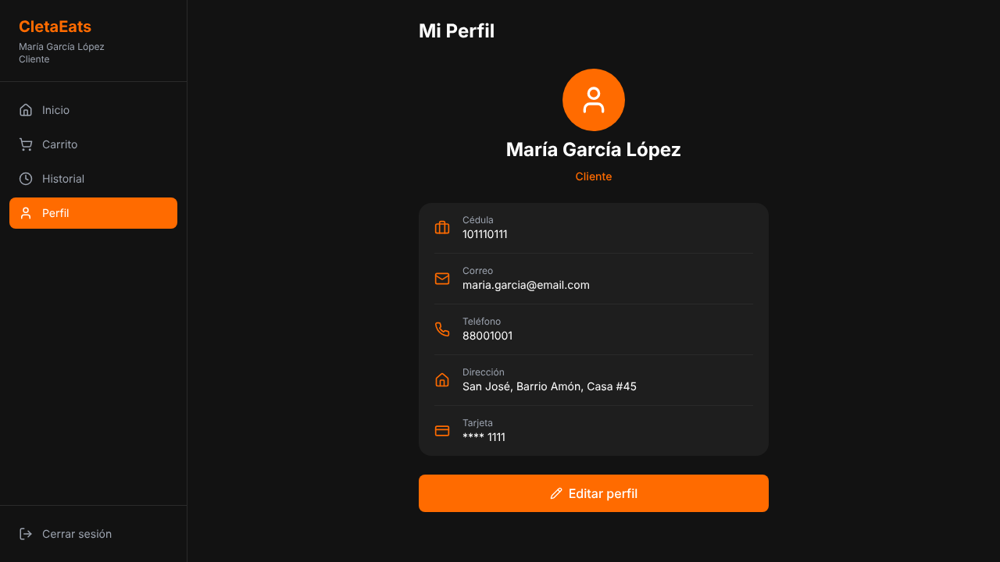
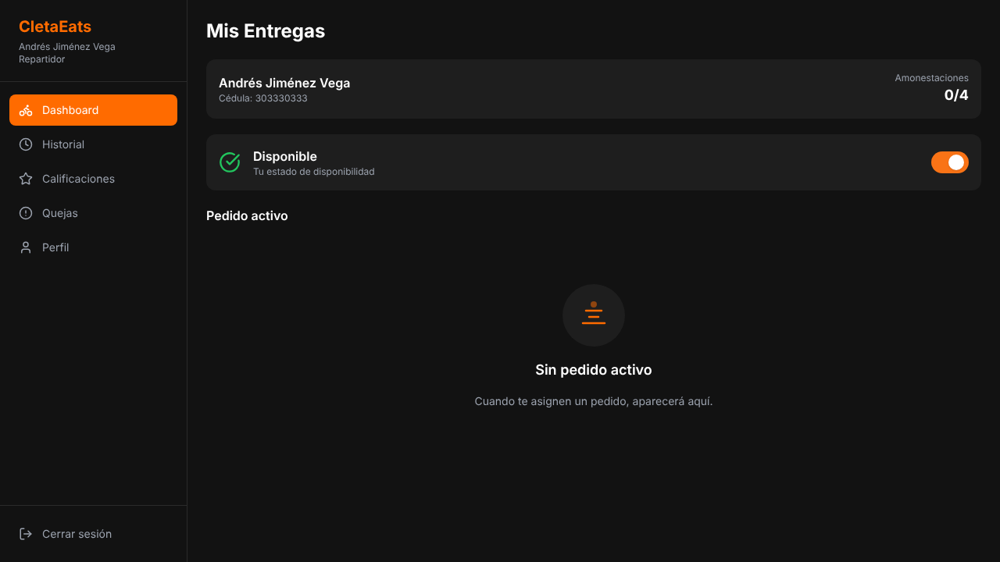
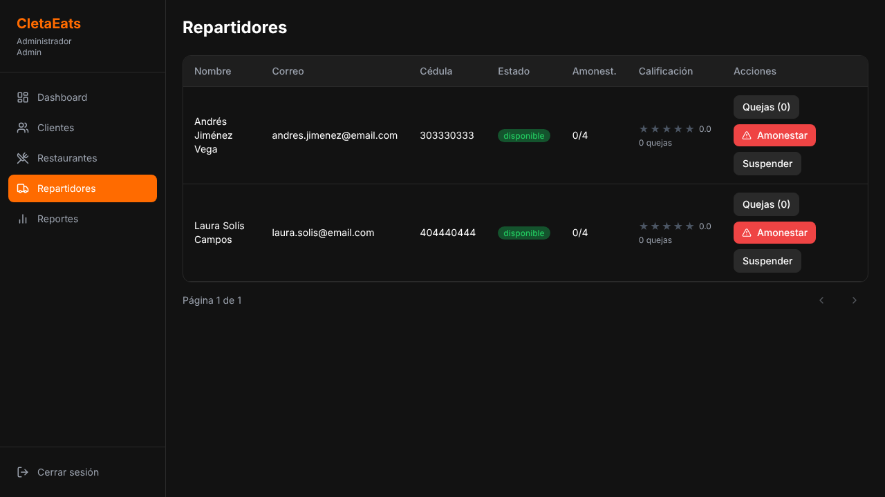
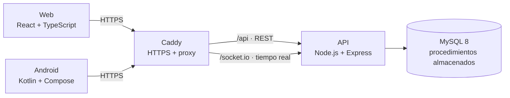

<div align="center">

# CletaEats

**Plataforma de delivery de comida para Heredia: web, app Android y una API compartida con seguimiento del repartidor en tiempo real.**

[](https://github.com/MementoMoriX29/cletaeats/actions/workflows/ci.yml)
[](https://github.com/MementoMoriX29/cletaeats/actions/workflows/codeql.yml)


</div>

> **EN ·** Food-delivery platform with three roles (customer, courier, admin): a React web app, an Android client and a shared Node.js/Express API on MySQL with stored procedures. Couriers are assigned automatically, invoices are computed server-side, and customers follow their courier live over authenticated Socket.IO. Access control, business rules and the realtime channel are covered by 36 integration tests that run against a real MySQL in CI.

<table>
<tr>
<td></td>
<td></td>
<td></td>
</tr>
<tr>
<td align="center"><sub>Cliente · perfil</sub></td>
<td align="center"><sub>Repartidor · entregas</sub></td>
<td align="center"><sub>Admin · repartidores</sub></td>
</tr>
</table>

---

## Qué hace

| Rol | Puede |
|---|---|
| **Cliente** | Ver restaurantes y combos, pedir, seguir al repartidor en el mapa, ver la factura y calificar la entrega |
| **Repartidor** | Conectarse o desconectarse, recibir pedidos asignados, marcarlos en camino o entregados, compartir su ubicación |
| **Admin** | Gestionar restaurantes, combos, clientes y repartidores, amonestar o suspender, y ver 12 reportes |

## Arquitectura



En producción, la web y la API comparten dominio: Caddy sirve la web y redirige `/api` y `/socket.io` al contenedor de la API. Así no hay CORS entre ellas y el HTTPS es automático.

| Parte | Tecnologías | Detalle |
|---|---|---|
| [`backend/`](backend) | Node.js 22, Express 5, Socket.IO, JWT, bcrypt, helmet | API en capas (rutas → servicios → repositorios → DAO). [README](backend/README.md) |
| [`db/`](db) | MySQL 8 | Esquema, 48 procedimientos almacenados y datos de prueba |
| [`web/`](web) | React 19, TypeScript, Vite, Tailwind, Leaflet, Recharts | Los tres roles, mapas con OpenStreetMap y reportes con gráficos |
| [`android/`](android) | Kotlin, Jetpack Compose, Retrofit, Room, WorkManager | Login, registro y perfil ([estado](android/README.md)) |

## Seguridad

Resumen; el detalle con la matriz de permisos y la relación con OWASP Top 10 está en [**SECURITY.md**](SECURITY.md).

- **Control de acceso en el servidor**: cada pedido, factura y ubicación solo la ven el cliente dueño, el repartidor asignado y el admin. El canal de tiempo real exige JWT y aplica las mismas reglas.
- **La tarjeta nunca se guarda completa**: solo los últimos 4 dígitos.
- **El servidor decide lo que afecta precio y reputación**: recargo por feriado, a quién se califica y una sola calificación por pedido.
- **Evidencia en CI**: tests de permisos contra MySQL real, CodeQL, gitleaks, `npm audit` y Dependabot.

## Correrlo en local

**Con Docker** (MySQL + API):

```bash
docker compose up -d --build
docker compose exec api npm run db:setup    # tablas, procedimientos y datos de prueba
cd web && npm install && npm run dev        # http://localhost:5173
```

**Sin Docker:** MySQL 8 y Node.js 22 instalados; seguí los pasos de [`backend/README.md`](backend/README.md#correrlo-en-local) y después `cd web && npm install && npm run dev`.

En desarrollo, Vite redirige `/api` y `/socket.io` a `localhost:3000`, igual que Caddy en producción. Usuarios de prueba: `maria.garcia@email.com` (cliente) y `andres.jimenez@email.com` (repartidor), contraseña `Password123`.

## Tests

```bash
cd backend && npm test      # 36 tests de integración (necesita MySQL; usa la base cletaeats_test)
```

Cubren autenticación, que nadie vea ni modifique datos ajenos, las reglas de pedidos y calificaciones, los estados del repartidor y el canal de Socket.IO. En GitHub Actions corren contra un MySQL 8 real en cada push, junto con el build de la web, la compilación de Android y la imagen Docker.

## Estructura

```
├── backend/          API REST + Socket.IO, tests y Dockerfile
├── db/               01_schema.sql · 02_routines.sql · 03_seed.sql
├── web/              cliente web (React + Vite)
├── android/          cliente Android (Kotlin + Compose)
├── docs/
│   ├── paper/        métricas y resumen técnico usados en el paper
│   ├── conflictos/   problemas encontrados y cómo se resolvieron, por plataforma
│   └── img/          capturas
├── docker-compose.yml
└── SECURITY.md
```

## Contexto académico

Proyecto del curso EIF-411 de la Universidad Nacional de Costa Rica (2026), desarrollado en equipo. Además de la aplicación, el proyecto incluyó un paper en formato IEEE que compara la complejidad de implementar el mismo cliente en React y en Kotlin/Jetpack Compose sobre un backend compartido; las métricas y los conflictos documentados están en [`docs/`](docs).
