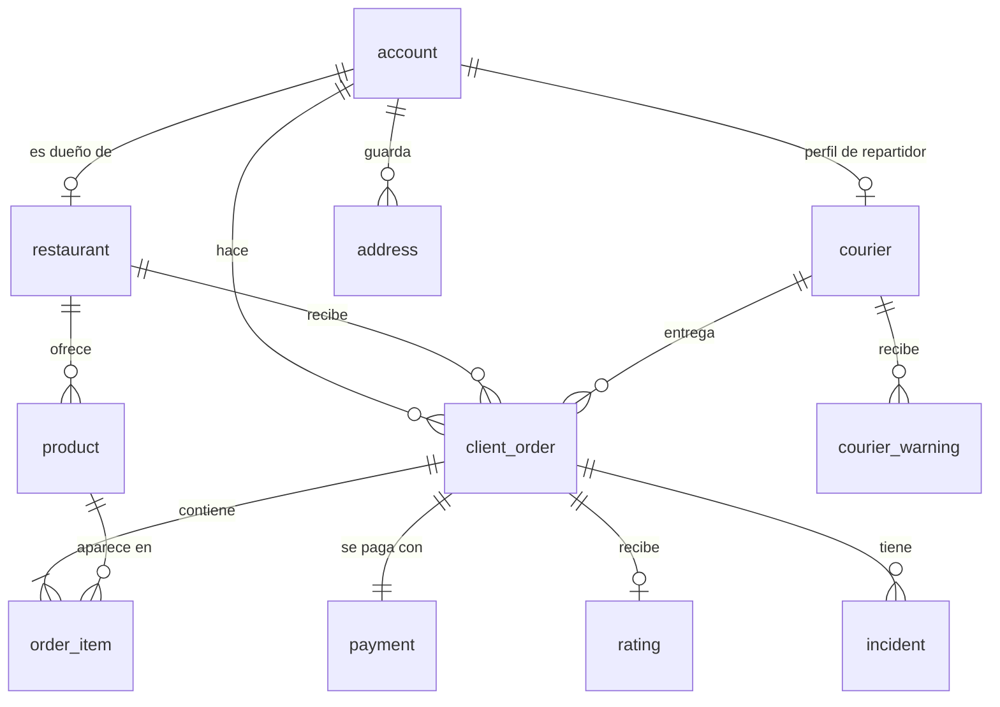

# CletaEats · Backend

API REST y servidor de tiempo real de CletaEats. La usan la web (React) y la app Android (Kotlin).

**Stack:** Node.js 22 · Express 5 · MySQL 8 (procedimientos almacenados) · Socket.IO · zod · JWT · bcrypt · Jest + Supertest

---

## Arquitectura en capas

```
routes/  →  services/  →  dao/  →  MySQL (procedimientos almacenados con transacciones)
   │            │
   │            ├─ pricing.js (cálculo de precios, función pura)
   │            └─ realtime/events.js (avisos por Socket.IO después de cada cambio)
   └─ middleware/ (sesión y roles, validación con zod, límites de peticiones, errores)
```

| Capa | Responsabilidad |
|---|---|
| `routes/` | Recibe la petición, aplica sesión, rol y validación, y devuelve la respuesta. Sin lógica de negocio. |
| `validation/` | Esquemas zod: validan y normalizan la entrada (correos en minúscula, teléfonos como `8888-8888`, textos recortados). |
| `services/` | Reglas de negocio: precios, quién ve qué parte de un pedido, transiciones, reembolsos, avisos en tiempo real. |
| `dao/` | Único lugar que habla con MySQL; casi todo pasa por procedimientos almacenados. |
| `realtime/` | Socket.IO autenticado con el mismo token y las mismas reglas de acceso que la API. |
| `jobs/` | Tarea periódica que cancela los pedidos que el restaurante no aceptó a tiempo. |

```
backend/
├── src/
│   ├── server.js            # Punto de entrada: HTTP + Socket.IO + tareas; cierre limpio con SIGTERM
│   ├── app.js               # App Express (la usan server.js y los tests)
│   ├── config/              # env (validación de variables) · db (pool MySQL en UTC) · cors
│   ├── middleware/          # auth (sesión y roles) · validate (zod) · rateLimits · errorHandler
│   ├── routes/              # auth · me · restaurants · orders · courier · merchant · admin
│   ├── services/            # auth · token · catalog · order · courier · merchant · admin · pricing
│   ├── dao/                 # una por entidad, sobre los procedimientos almacenados
│   ├── realtime/            # socket (conexiones y salas) · events (avisos)
│   ├── jobs/                # expirePendingOrders
│   ├── validation/          # schemas (zod)
│   └── utils/               # errores · distancia · feriados de Costa Rica · fechas en hora de CR
├── scripts/
│   ├── db-setup.js          # crea la BD, carga ../db/*.sql y genera pedidos de ejemplo
│   ├── seed-history.js      # 30 días de pedidos de demostración para los indicadores
│   └── create-admin.js      # crea la cuenta de soporte (o le cambia la contraseña)
├── tests/                   # tests de integración contra MySQL real
└── Dockerfile
```

---

## Correrlo en local

**Requisitos:** Node.js 22 y MySQL 8 (o Docker, ver el [README principal](../README.md)).

```bash
cd backend
npm install
cp .env.example .env               # completá DB_* y JWT_SECRET
npm run db:setup                   # tablas, procedimientos y datos de demostración
npm run create-admin -- soporte@tudominio.com "Nombre Apellido"   # pide la contraseña (mínimo 12 caracteres)
npm run dev                        # http://localhost:3000/health
```

### Variables de entorno

| Variable | Obligatoria | Descripción |
|---|:-:|---|
| `DB_HOST`, `DB_PORT`, `DB_USER`, `DB_PASSWORD`, `DB_NAME` | ✔ | Conexión a MySQL |
| `JWT_SECRET` | ✔ | Mínimo 32 caracteres (`openssl rand -base64 48`). Si falta o es corta, el servidor no arranca. |
| `CORS_ORIGINS` | | Orígenes web permitidos, separados por coma. En desarrollo cualquier `localhost` ya está permitido. |
| `JWT_EXPIRES_IN` | | Duración de la sesión. Por defecto `7d`; igual se puede revocar en cualquier momento (ver [SECURITY.md](../SECURITY.md)). |
| `BCRYPT_ROUNDS` | | Costo de bcrypt. Por defecto 12. |
| `PENDING_ORDER_TIMEOUT_MIN` | | Minutos que tiene el restaurante para aceptar un pedido. Por defecto 15. |
| `NODE_ENV`, `PORT` | | `production` desactiva el acceso desde `localhost` por CORS. Puerto por defecto: 3000. |

### Scripts

| Comando | Qué hace |
|---|---|
| `npm run dev` | Servidor con recarga automática |
| `npm start` | Servidor de producción |
| `npm test` | Tests de integración (usan una base aparte, `cletaeats_test`, que se borra y recrea) |
| `npm run db:setup` | Crea lo que falta y carga los datos de demostración. `-- --no-seed` sin datos · `-- --no-history` sin pedidos de ejemplo · `-- --reset` borra la base primero |
| `npm run create-admin -- correo "Nombre"` | Crea la cuenta de soporte o le cambia la contraseña. Sin interacción: variable `ADMIN_PASSWORD`. |

`db:setup` guarda la versión del esquema; si encuentra una base de la versión 1 (combos, roles con nombre en español) no la toca y pide recrearla con `--reset`.

---

## Referencia de la API

Todas las rutas cuelgan de `/api`. Las protegidas esperan `Authorization: Bearer <token>`.
La matriz completa de permisos está en [SECURITY.md](../SECURITY.md#matriz-de-permisos).

Los errores siempre tienen la misma forma. `fields` aparece cuando hay datos inválidos y trae el mensaje de cada campo:

```json
// 400
{ "error": "Ingresá un teléfono de 8 dígitos", "code": "BAD_REQUEST", "fields": { "phone": "Ingresá un teléfono de 8 dígitos" } }
// 409
{ "error": "Otro repartidor ya aceptó este pedido", "code": "ORDER_TAKEN" }
```

### Cuenta — `/api/auth` y `/api/me`

| Método | Ruta | Acceso | Descripción |
|---|---|---|---|
| `POST` | `/auth/register` | Público | Cuenta de cliente: `name`, `email`, `phone`, `password`. Devuelve `{ token, user }`. |
| `POST` | `/auth/register-courier` | Público | Solicitud de repartidor: además `national_id` y `vehicle` (`bicicleta` · `scooter`). Queda `pending`. |
| `POST` | `/auth/login` | Público | `email`, `password`. Un solo login: el rol sale de la cuenta. |
| `GET` `PUT` | `/me` | con sesión | Datos de la cuenta; se pueden cambiar `name` y `phone`. |
| `PUT` | `/me/password` | con sesión | Cambia la contraseña, cierra las demás sesiones y devuelve una nueva. |
| `GET` `POST` `PUT` `DELETE` | `/me/addresses`, `/me/addresses/:id` | cliente | Direcciones guardadas (máximo 10, dentro de Costa Rica). |

Login y registro comparten un límite de 20 intentos cada 15 minutos por IP.

### Catálogo — `/api/restaurants` (público)

| Método | Ruta | Descripción |
|---|---|---|
| `GET` | `/?search=&category=&lat=&lng=` | Restaurantes activos, los abiertos primero. Con `lat`/`lng` agrega `delivery`: distancia, si llega, costo de envío y tiempo estimado. `search` busca también por plato. |
| `GET` | `/categories` | Categorías con su cantidad de restaurantes |
| `GET` | `/:id` | Ficha con el menú por secciones, incluidos los productos agotados |

### Pedidos — `/api/orders`

| Método | Ruta | Acceso | Descripción |
|---|---|---|---|
| `POST` | `/quote` | cliente | Cotiza sin crear nada: el servidor calcula todo con los productos y la dirección. |
| `POST` | `/` | cliente | Crea el pedido con su pago (máximo 10 por minuto). |
| `GET` | `/` | cliente | Sus pedidos |
| `GET` | `/:id` | quien participa · soporte | Detalle; cada rol recibe solo los datos que necesita. Para cualquier otra persona responde **404**. |
| `POST` | `/:id/cancel` | cliente | Solo mientras está por confirmar; si pagó con tarjeta se reembolsa. |
| `POST` | `/:id/rating` | cliente | `courier_stars` y `restaurant_stars` (1–5) y comentario; una vez, con el pedido entregado. |
| `POST` | `/:id/incidents` | cliente | Reporte de un problema para soporte. |
| `POST` | `/:id/accept` · `/:id/reject` · `/:id/ready` | restaurante dueño | Acepta (con `prep_minutes`), rechaza (con `reason`) o marca listo. |
| `POST` | `/:id/claim` · `/:id/pickup` · `/:id/deliver` | repartidor | Acepta la oferta (el primero se la lleva), retira y entrega. |

```json
// POST /api/orders/quote
{
  "restaurant_id": 1,
  "items": [{ "product_id": 103, "quantity": 2 }, { "product_id": 110, "quantity": 1 }],
  "delivery": { "address_id": 3 },
  "tip": 500
}

// → 200 (resumido)
{
  "items": [
    { "product_id": 103, "name": "Casado de pollo", "unit_price": 4200, "quantity": 2, "line_total": 8400 },
    { "product_id": 110, "name": "Arroz con leche", "unit_price": 1300, "quantity": 1, "line_total": 1300 }
  ],
  "distance_km": 1.9,
  "subtotal": 9700, "iva_included": 1116,
  "delivery_fee": 1400, "service_fee": 490, "tip": 500, "total": 12090,
  "is_holiday": false, "eta_min": 28, "eta_max": 38
}
```

`POST /api/orders` recibe lo mismo más `notes`, `expected_total` (el total que vio el cliente: si cambió, responde 409 en lugar de cobrar otro monto) y `payment`:

```json
{ "method": "card", "card_token": "tok_…", "card_brand": "visa", "card_last4": "4242" }
{ "method": "sinpe", "sinpe_reference": "48120937" }
{ "method": "cash", "cash_change_for": 20000 }
```

### Repartidor — `/api/courier`

| Método | Ruta | Descripción |
|---|---|---|
| `GET` | `/me` | Perfil, entrega en curso y ganancias de hoy, la semana y el total |
| `PUT` | `/availability` | Conectarse o desconectarse (no con una entrega en curso) |
| `GET` | `/offers` | Pedidos aceptados por restaurantes y todavía sin repartidor, con distancia y ganancia |
| `POST` | `/location` | Ubicación por HTTP (la web usa el socket) |
| `GET` | `/history` | Entregas, ganancias y calificaciones |

Solo un repartidor aprobado (`active`) puede conectarse y tomar pedidos.

### Restaurante — `/api/merchant`

| Método | Ruta | Descripción |
|---|---|---|
| `GET` `PUT` | `/store` | Su tienda y el resumen del día; ajustes (descripción, teléfonos, SINPE, foto `https`, tiempo de preparación) |
| `PUT` | `/store/open` | Abrir o cerrar la tienda |
| `GET` | `/orders?scope=history` | Pedidos en curso (por defecto) o terminados |
| `GET` `POST` `PUT` `PATCH` `DELETE` | `/menu`, `/products`, `/products/:id`, `/products/:id/availability` | Menú: alta, edición, agotado y borrado (lógico: los pedidos viejos lo siguen mostrando) |

### Soporte — `/api/admin`

| Método | Ruta | Descripción |
|---|---|---|
| `GET` | `/overview?days=7\|30\|90` | Indicadores: ventas, pedidos por día y por hora, restaurantes con más ventas, reparto del dinero, métodos de pago |
| `GET` · `POST` | `/orders` · `/orders/:id/cancel` | Pedidos de toda la plataforma; cancelar uno abierto (con reembolso) |
| `GET` · `POST` | `/couriers` · `/couriers/:id/approve\|reject\|suspend\|reactivate` · `/couriers/:id/warnings` | Solicitudes y gestión de repartidores |
| `GET` `POST` `PUT` | `/restaurants` · `/restaurants/:id` · `/restaurants/:id/activate\|deactivate` | Alta con la cuenta del dueño (devuelve una contraseña temporal que se muestra una vez) y edición |
| `GET` · `POST` | `/clients?search=` · `/clients/:id/suspend\|reactivate` | Clientes |
| `GET` · `POST` | `/incidents?status=` · `/incidents/:id/resolve` | Reportes; al resolver se puede reembolsar y amonestar al repartidor |

### Salud

`GET /health` (o `/api/health`) → `200 {"status":"ok"}` si la API y la base de datos responden; `503` si la BD no está disponible. Lo usa el `HEALTHCHECK` de Docker.

---

## Tiempo real (Socket.IO)

```js
const socket = io(URL, { auth: { token } });        // sin sesión válida → connect_error "No autorizado"

// Seguir un pedido: mismas reglas que GET /api/orders/:id
socket.emit('order:watch', orderId, ({ ok, location }) => { … });
socket.on('order:updated', ({ id }) => { /* volver a pedir el pedido */ });
socket.on('courier:location', ({ order_id, lat, lng, at }) => { … });

// Restaurante: llegan los pedidos nuevos.  Repartidores conectados: cambian las ofertas.
socket.on('order:created', ({ id }) => { … });
socket.on('offers:changed', () => { … });

// Solo un repartidor con una entrega en curso (como mucho cada 3 s):
socket.emit('courier:location', { lat, lng });
```

Los avisos no llevan datos del pedido: cada pantalla vuelve a pedirlo por la API, que aplica los permisos. Al suspender una cuenta se cierran sus conexiones.

---

## Reglas de negocio

**Precio** (`services/pricing.js`, función pura con sus propios tests):

```
distancia     = línea recta × 1,3                    (las calles no van en línea recta)
envío         = ₡700 + ₡350 × km, redondeado a ₡50 hacia arriba; +25 % en feriados nacionales
servicio      = 5 % del subtotal, entre ₡250 y ₡1 500
IVA incluido  = subtotal × 13 / 113                  (los precios del menú ya lo incluyen)
total         = subtotal + envío + servicio + propina
```

El radio máximo es 7 km. El repartidor gana el envío más la propina; la plataforma, la tarifa de servicio.

**Estados del pedido:** `pending` → `accepted` → `ready` → `picked_up` → `delivered`, o `cancelled`. El repartidor puede tomar el pedido desde `accepted`. Cada procedimiento bloquea la fila del pedido (`SELECT … FOR UPDATE`) y verifica el estado esperado dentro de una transacción.

**Pagos:** tarjeta pagada al crear el pedido; SINPE Móvil pagado cuando el restaurante acepta; efectivo pagado al entregar. Si el pedido se cancela con el pago hecho, queda `refunded`.

**Cancelación automática:** si el restaurante no acepta en `PENDING_ORDER_TIMEOUT_MIN` minutos (15), la tarea de `jobs/` lo cancela y reembolsa.

**Repartidores:** un pedido a la vez. Con 4 amonestaciones (de soporte o al resolver un reporte) la cuenta queda suspendida; al reactivarla se reinician.

---

## Base de datos

Los scripts están en [`/db`](../db): `01_schema.sql` (12 tablas y 2 vistas), `02_routines.sql` (64 procedimientos) y `03_seed.sql` (datos de demostración).



- Una sola tabla de cuentas para todos los roles; el perfil del repartidor y el restaurante cuelgan de ella.
- El pedido guarda una copia de la dirección y cada línea guarda el nombre y el precio del producto al momento de pedir: si después cambian, el pedido no cambia.
- Restricciones en la BD: llaves foráneas, `UNIQUE` (correo, cédula, cédula jurídica, una calificación por pedido) y `CHECK` (estrellas 1–5, precios, cantidades, `total = subtotal + envío + servicio + propina`).
- Fechas en UTC; los días y los feriados se calculan en hora de Costa Rica.
- `client_order` se llama así porque `ORDER` es palabra reservada.
