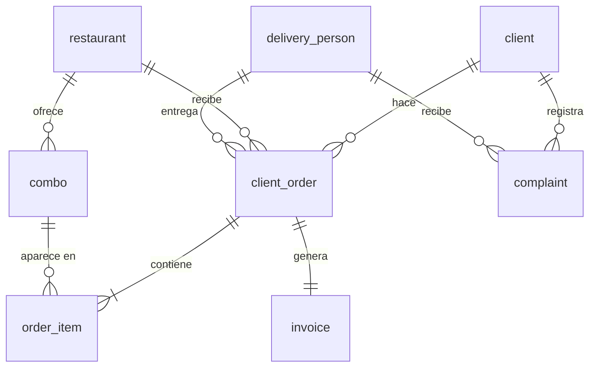

# CletaEats · Backend

API REST y servidor de tiempo real de CletaEats. La comparten la web (React) y la app Android (Kotlin).

**Stack:** Node.js 22 · Express 5 · MySQL 8 (procedimientos almacenados) · Socket.IO · JWT · bcrypt · Jest + Supertest

---

## Arquitectura en capas

```
routes/  →  services/  →  repositories/  →  dao/  →  MySQL (procedimientos almacenados)
   │            │
   │            └─ models/ (validación de entrada) · utils/ (tarjeta, feriados)
   └─ middleware/ (JWT, roles, errores)
```

| Capa | Responsabilidad |
|---|---|
| `routes/` | Recibe la petición, aplica autenticación y roles, devuelve la respuesta. Sin lógica de negocio. |
| `services/` | Reglas de negocio: precios, asignación de repartidor, quién puede ver qué. |
| `models/` | Validan formato y valores de entrada antes de tocar la BD. |
| `repositories/` | Convierten los resultados crudos del DAO en objetos limpios. |
| `dao/` | Único lugar que habla con MySQL; casi todo pasa por procedimientos almacenados. |
| `socket/` | Seguimiento del repartidor en tiempo real (Socket.IO, autenticado con JWT). |

```
backend/
├── src/
│   ├── server.js            # Punto de entrada: HTTP + Socket.IO, cierre limpio con SIGTERM
│   ├── app.js               # App Express (la usan server.js y los tests)
│   ├── config/              # env (validación de variables) · db (pool MySQL) · cors
│   ├── middleware/          # authMiddleware (JWT) · roleMiddleware · errorHandler
│   ├── routes/ services/ repositories/ dao/ models/
│   ├── socket/trackingSocket.js
│   └── utils/               # card (solo últimos 4 dígitos) · holidays (feriados de CR)
├── scripts/
│   ├── db-setup.js          # crea la BD y carga ../db/*.sql
│   └── hash-password.js     # genera el hash bcrypt del admin
├── tests/                   # tests de integración contra MySQL real
└── Dockerfile
```

---

## Correrlo en local

**Requisitos:** Node.js 22 y MySQL 8 (o Docker, ver el [README principal](../README.md)).

```bash
cd backend
npm install
cp .env.example .env              # completá DB_*, JWT_SECRET y el admin
npm run hash-password -- "una-contraseña-larga-para-el-admin"   # pegá el resultado en ADMIN_PASSWORD_HASH
npm run db:setup                  # crea tablas, procedimientos y datos de prueba
npm run dev                       # http://localhost:3000/health
```

### Variables de entorno

| Variable | Obligatoria | Descripción |
|---|:-:|---|
| `DB_HOST`, `DB_PORT`, `DB_USER`, `DB_PASSWORD`, `DB_NAME` | ✔ | Conexión a MySQL |
| `JWT_SECRET` | ✔ | Mínimo 32 caracteres (`openssl rand -base64 48`). Si falta o es corta, el servidor no arranca. |
| `CORS_ORIGINS` | | Orígenes web permitidos, separados por coma. En desarrollo `localhost` ya está permitido. |
| `ADMIN_EMAIL`, `ADMIN_PASSWORD_HASH` | | Admin único. Sin ellas, el login de admin queda deshabilitado. |
| `NODE_ENV`, `PORT` | | `production` desactiva el acceso desde `localhost` por CORS. Puerto por defecto: 3000. |

### Scripts

| Comando | Qué hace |
|---|---|
| `npm run dev` | Servidor con recarga automática |
| `npm start` | Servidor de producción |
| `npm test` | Tests de integración (usa una base aparte, `cletaeats_test`, que se borra y recrea) |
| `npm run db:setup` | Crea/actualiza la BD. `-- --no-seed` sin datos de prueba · `-- --reset` la borra primero |
| `npm run hash-password -- "clave"` | Hash bcrypt para `ADMIN_PASSWORD_HASH` |

### Usuarios de prueba (`db/03_seed.sql`)

| Rol | Correo | Contraseña |
|---|---|---|
| Cliente | `maria.garcia@email.com` | `Password123` |
| Cliente | `carlos.rodriguez@email.com` | `Password123` |
| Repartidor | `andres.jimenez@email.com` | `Password123` |
| Repartidor | `laura.solis@email.com` | `Password123` |
| Admin | el de `ADMIN_EMAIL` | la que usaste en `hash-password` |

---

## Referencia de la API

Todas las rutas cuelgan de `/api`. Las protegidas esperan `Authorization: Bearer <token>`.
La matriz completa de permisos está en [SECURITY.md](../SECURITY.md#matriz-de-permisos).

### Autenticación — `/api/auth`

| Método | Ruta | Acceso | Descripción |
|---|---|---|---|
| `POST` | `/register-client` | Público (20 intentos / 15 min) | Registra un cliente |
| `POST` | `/register-delivery-person` | Público (20 intentos / 15 min) | Registra un repartidor |
| `POST` | `/login` | Público (20 intentos / 15 min) | Devuelve `{ token, user }`. Body: `email`, `password`, `rol` (`cliente` · `repartidor` · `admin`) |

El token dura **2 horas**. El registro recibe el número de tarjeta completo solo para validarlo: se guarda y se devuelve únicamente `card_last4`.

```json
// POST /api/auth/login → 200
{
  "token": "eyJhbGciOiJIUzI1NiIs…",
  "user": { "id": 1, "name": "María García López", "card_last4": "1111", "status": "active", "rol": "cliente" }
}
```

### Clientes — `/api/clients`

| Método | Ruta | Acceso | Descripción |
|---|---|---|---|
| `GET` | `/` | admin | Lista de clientes |
| `GET` | `/:id` | el mismo cliente · admin | Perfil |
| `PUT` | `/:id` | el mismo cliente · admin | Actualiza perfil. `tarjeta`/`card_number` es opcional: si no viene se conserva la actual |
| `PUT` | `/:id/status` | admin | `activo` · `suspendido` |

### Restaurantes — `/api/restaurants`

| Método | Ruta | Acceso | Descripción |
|---|---|---|---|
| `GET` | `/`, `/:id`, `/:id/combos` | Público | Catálogo |
| `POST` `PUT` `DELETE` | `/`, `/:id` | admin | Gestión de restaurantes |
| `POST` `PUT` `DELETE` | `/:id/combos`, `/:id/combos/:comboId` | admin | Gestión de combos |

### Repartidores — `/api/delivery-persons`

| Método | Ruta | Acceso | Descripción |
|---|---|---|---|
| `GET` | `/` | admin | Lista con calificación promedio |
| `GET` `PUT` | `/:id` | el mismo repartidor · admin | Perfil (tarjeta opcional, igual que clientes) |
| `PUT` | `/:id/status` | el mismo repartidor · admin | El repartidor solo puede `disponible` ↔ `inactivo` (y no si está suspendido u ocupado). El admin además puede `suspendido`. |
| `GET` | `/:id/deliveries`, `/:id/active-order`, `/:id/complaints`, `/:id/ratings` | el mismo repartidor · admin | Historial, pedido activo, quejas |
| `GET` | `/:id/rating` | autenticado | Promedio de calificación |
| `POST` | `/:id/warn` | admin | Amonestación (a la 4.ª queda suspendido) |
| `POST` | `/:id/complaints` | cliente atendido por ese repartidor | Queja |

### Pedidos — `/api/orders`

| Método | Ruta | Acceso | Descripción |
|---|---|---|---|
| `POST` | `/` | cliente | Crea el pedido. El `client_id` sale del token. |
| `GET` | `/client/:clientId` | el mismo cliente · admin | Historial |
| `GET` | `/:id`, `/:id/invoice`, `/:id/location` | cliente dueño · repartidor asignado · admin | Detalle, factura y última ubicación. Para cualquier otro usuario responde **404** (no revela si el pedido existe). |
| `PUT` | `/:id/status` | repartidor asignado · admin | `en_camino` · `entregado` · `cancelado`. Un pedido entregado o cancelado ya no cambia. |
| `POST` | `/:id/rating` | cliente dueño | Una sola vez por pedido, valores 1–5. Siempre califica al repartidor que entregó. |

```json
// POST /api/orders
{
  "restaurante_id": 1,
  "items": [{ "combo_id": 1, "cantidad": 2 }, { "combo_id": 3, "cantidad": 1 }],
  "distance_km": 3.5,
  "direccion_entrega": "Heredia, San Francisco, casa 12",
  "notas": "Portón negro"
}

// → 201 (resumido)
{
  "id": 1, "estado": "pendiente", "repartidor_id": 1, "repartidor_nombre": "Andrés Jiménez Vega",
  "subtotal": 14000, "transport_cost": 3500, "iva": 1820, "total": 19320,
  "restaurante_nombre": "La Soda Tica", "restaurante_lat": 9.9981, "restaurante_lng": -84.1197,
  "items": [{ "combo_id": 1, "cantidad": 2, "precio_unitario": "4000.00", "nombre": "Rice and beans with egg and sour cream" }]
}
```

Errores: `400` datos inválidos, combo de otro restaurante o no disponible, distancia > 50 km · `403` cliente suspendido · `404` restaurante o combo inexistente · `503` no hay repartidores disponibles.

### Reportes — `/api/reports` (solo admin)

`/clients/active` · `/clients/suspended` · `/clients/most-orders` · `/restaurants` · `/restaurants/most-orders` · `/restaurants/least-orders` · `/restaurants/sales-by-restaurant` · `/restaurants/total-sales` · `/delivery-persons/no-warnings` · `/delivery-persons/complaints` · `/orders/by-client` · `/orders/peak-hours`

### Salud

`GET /health` (o `/api/health`) → `200 {"status":"ok"}` si la API y la base de datos responden; `503` si la BD no está disponible. Lo usa el `HEALTHCHECK` de Docker.

---

## Seguimiento en tiempo real (Socket.IO)

```js
const socket = io(URL, { auth: { token } });          // sin token válido → connect_error "No autorizado"
socket.emit('join_order', orderId);                   // cliente dueño, repartidor asignado o admin
socket.on('repartidor_location', ({ orderId, lat, lng }) => { … });
socket.on('tracking_error', ({ orderId, error }) => { … });

// Solo el repartidor asignado, con el pedido en camino:
socket.emit('location_update', { orderId, lat, lng });
```

Las ubicaciones de otros repartidores o con coordenadas inválidas se ignoran. La última ubicación de cada pedido se guarda en memoria durante 2 horas.

---

## Reglas de negocio

**Precio de combos:** `(número de combo + 3) × ₡1.000` → combo 1 = ₡4.000 … combo 9 = ₡12.000.

**Factura** (se genera al crear el pedido):

```
subtotal   = Σ precio × cantidad
transporte = km × (₡1.500 en feriado, ₡1.000 en día hábil)   ← el servidor decide si es feriado (hora de Costa Rica)
iva        = 13 % del subtotal
total      = subtotal + transporte + iva
```

**Estados del pedido:** `pendiente` → `en_camino` → `entregado`, o `cancelado`. Al entregar o cancelar, el repartidor vuelve a `disponible`.

**Asignación de repartidor:** el primer repartidor `disponible` (ID más bajo) con menos de 4 amonestaciones. Pasa a `ocupado`.

**Estados del repartidor:**

| Estado | Significado | Quién lo pone |
|---|---|---|
| `available` · disponible | Puede recibir pedidos | El repartidor, el admin, el sistema al cerrar un pedido |
| `busy` · ocupado | Tiene un pedido activo | El sistema |
| `offline` · inactivo | Se desconectó por su cuenta | El repartidor o el admin |
| `suspended` · suspendido | No puede iniciar sesión ni recibir pedidos | El admin, o automático a las 4 amonestaciones |

**Calificaciones:** una por pedido entregado. Si el promedio es menor a 2, suma una amonestación.

---

## Base de datos

Los scripts están en [`/db`](../db): `01_schema.sql` (tablas), `02_routines.sql` (48 procedimientos y 4 funciones) y `03_seed.sql` (datos de prueba).



- `client_order` se llama así porque `ORDER` es palabra reservada.
- Restricciones en la BD: llaves foráneas, `UNIQUE` (cédula, correo, combo por restaurante) y `CHECK` (combos 1–9, calificaciones 1–5).
- Convención: `sp_<acción>_<entidad>` (`sp_get_client_by_email`, `sp_report_peak_hours`) y `fn_calculate_*`.
- Las funciones `fn_*` requieren `log_bin_trust_function_creators=ON` cuando hay binlog (HeatWave, MySQL por defecto). Como la API calcula la factura en Node, `db:setup` las omite con un aviso si no hay permiso.
